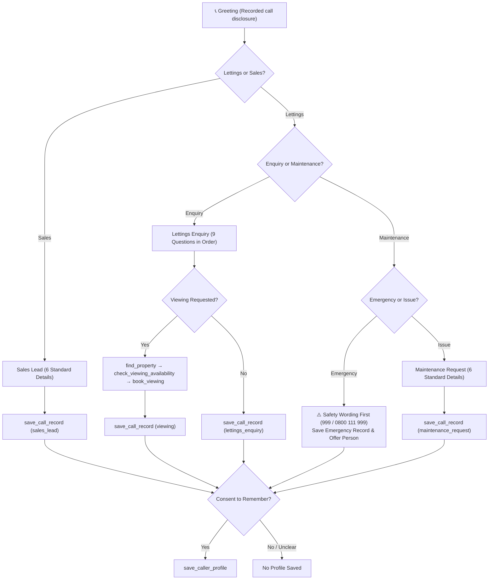

# Voice Agent Starter — Powered by Murf Falcon

Build a production voice AI agent in 5 minutes. Powered by the fastest TTS on the market - swap the system prompt to build anything from customer support to language tutors.

[](https://opensource.org/licenses/MIT) [](https://murf.ai/api/docs/text-to-speech/streaming) [](https://docs.livekit.io) [](https://www.typescriptlang.org/) [](https://www.python.org/)

---

## Why Murf Falcon

- **55ms model latency** - fastest production TTS
- **130ms time-to-first-audio** across 10+ global regions
- **$0.01/1000 characters** - up to 10x cheaper than alternatives
- **150+ voices** across 35+ languages
- **99.38% pronunciation accuracy**

---

## Architecture


---

## Quickstart

### Prerequisites

- **Python** 3.10+
- **[uv](https://docs.astral.sh/uv/)** - fast Python package manager
  ```bash
  # macOS/Linux
  curl -LsSf https://astral.sh/uv/install.sh | sh
  # Windows (PowerShell)
  powershell -ExecutionPolicy ByPass -c "irm https://astral.sh/uv/install.ps1 | iex"
  ```
- **Node.js** 18+
- **pnpm** — fast Node package manager
  ```bash
  npm install -g pnpm
  ```
- A [LiveKit](https://cloud.livekit.io/) project (free tier available)

### Step 1: Clone the repo

```bash
git clone https://github.com/murf-ai/murf-livekit-starter.git
cd murf-livekit-starter
```

### Step 2: Set up environment variables

Create `.env.local` in both `backend/` and `frontend/` (copy from `.env.example` in each). You need:

| Variable                               | Where to get it                                        | Required |
| -------------------------------------- | ------------------------------------------------------ | -------- |
| `LIVEKIT_URL`                          | LiveKit Cloud dashboard                                | Yes      |
| `LIVEKIT_API_KEY`                      | LiveKit Cloud dashboard                                | Yes      |
| `LIVEKIT_API_SECRET`                   | LiveKit Cloud dashboard                                | Yes      |
| `MURF_API_KEY`                         | [murf.ai/api/dashboard](https://murf.ai/api/dashboard) | Yes      |
| `DEEPGRAM_API_KEY`                     | [deepgram.com](https://deepgram.com)                   | Yes      |
| `GOOGLE_API_KEY` (or `OPENAI_API_KEY`) | Depends on LLM choice                                  | Yes      |

### Step 3: Install backend dependencies

```bash
cd backend
uv sync
uv run python src/agent.py download-files
```

### Step 4: Install frontend dependencies

```bash
cd frontend
pnpm install
```

### Step 5: Run it

**Option A - All-in-one (from repo root):**

```bash
# macOS/Linux
chmod +x start_app.sh
./start_app.sh

# Windows (PowerShell)
.\start_app.ps1
```

**Option B - Separate terminals:**

```bash
# Terminal 1 — LiveKit Server
livekit-server --dev

# Terminal 2 — Backend agent
cd backend && uv run python src/agent.py dev

# Terminal 3 — Frontend
cd frontend && pnpm dev
```

Then open **http://localhost:3000** in your browser.

You should now see the voice agent UI. Click **Start talking**, allow microphone access, and speak — the agent will respond with Murf Falcon TTS. Ensure your backend and (if using Option B) LiveKit server are running.

---

## Deploy

Want to deploy this beyond localhost? You'll need to deploy **two services**: the backend agent and the frontend. Both must use the same LiveKit project.

> This is a two-service app — the backend agent and the frontend UI deploy separately. You'll need both running and connected to the same LiveKit project.

### Backend (Python agent) — Deploy to Railway

[](https://railway.com/deploy/tIVCF1?referralCode=cNjn2P&utm_medium=integration&utm_source=template&utm_campaign=generic)

Set these environment variables in Railway:

- `MURF_API_KEY`
- `DEEPGRAM_API_KEY`
- `GOOGLE_API_KEY` or `OPENAI_API_KEY`
- `LIVEKIT_URL`
- `LIVEKIT_API_KEY`
- `LIVEKIT_API_SECRET`

The backend runs as a long-lived Python process that connects to LiveKit as an agent. Railway handles this well.

### Frontend (Next.js) — Deploy to Vercel

[](https://vercel.com/new/clone?repository-url=https://github.com/murf-ai/murf-livekit-starter&root-directory=frontend&env=LIVEKIT_URL,LIVEKIT_API_KEY,LIVEKIT_API_SECRET&project-name=murf-voice-agent&repository-name=murf-voice-agent)

Set these environment variables in Vercel:

- `LIVEKIT_URL`
- `LIVEKIT_API_KEY`
- `LIVEKIT_API_SECRET`
- `AGENT_NAME` (optional — for explicit agent dispatch)

The frontend is a standard Next.js app. Point it at the same LiveKit instance your backend agent is connected to.

### Connecting them

The frontend and backend don't call each other directly — they both connect to **LiveKit**, which handles the real-time audio transport.

1. Use the **same** `LIVEKIT_URL`, `LIVEKIT_API_KEY`, and `LIVEKIT_API_SECRET` on both Railway and Vercel
2. Set `AGENT_NAME=my-agent` on Vercel — this matches the `agent_name="my-agent"` registered in `backend/src/agent.py`
3. Verify: Railway logs should show the agent connected to LiveKit. Open your Vercel URL, click **Start talking** — the agent should respond

If the agent doesn't connect, double-check that both services point to the same LiveKit project and that the backend is running (check Railway logs).

---

---

## MyCitiPad Virtual Receptionist

An enterprise voice AI receptionist engineered for **MyCitiPad**, a UK property lettings and sales agency. Powered by LiveKit Agents, Murf Falcon 2 TTS (Hazel UK English), Deepgram Nova-3 STT, and Google Gemini. The agent handles inbound calls, screens and routes enquiries, enforces strict real estate compliance guardrails, books viewings against an SQLite-backed calendar, remembers returning callers with explicit consent, and escalates to human agents when requested.



### 1. Setup & Environment Variables

In addition to the starter's standard keys (`LIVEKIT_URL`, `LIVEKIT_API_KEY`, `LIVEKIT_API_SECRET`, `MURF_API_KEY`, `DEEPGRAM_API_KEY`, `GOOGLE_API_KEY`), the MyCitiPad agent supports these runtime configuration switches in `backend/.env.local`:

| Variable | Description | Default |
|---|---|---|
| `MCP_DB_PATH` | Path to the SQLite database file | `backend/data/mycitipad.db` |
| `MCP_HUMAN_AVAILABLE` | Simulates live human operator availability (`true` / `false`) | `false` |
| `MCP_SIMULATE_FAILURE` | Injects controlled tool failure (`properties`, `calendar`, `records`, `handover`, `callback`) | `""` (none) |

#### Running the Full Stack:
```bash
# Terminal 1 — Backend (with auto-reload)
cd backend
uv sync
uv run python src/db.py          # Initialize & seed SQLite database
uv run python src/agent.py dev   # Start agent worker

# Terminal 2 — Frontend
cd frontend
pnpm install
pnpm dev
```
Open **http://localhost:3000** to interact with the MyCitiPad branded interface.

---

### 2. Quoted Call Objectives, Guardrails & Escalation

Directly quoted from [`backend/src/prompt.py`](backend/src/prompt.py):

#### Call Objectives
```text
A successful call does one of these:
1. Routes the caller to the right path (lettings enquiry, maintenance
   emergency, maintenance issue, or sales) within two turns.
2. Collects every required detail for that path, one question at a
   time, and saves it with the correct tool.
3. Ends with a confirmed outcome: viewing booked, request/lead saved,
   call transferred, or callback number logged. Never end without one.
```

#### Guardrails
```text
 - Never state a viewing is booked, a lead is saved, or a call is
   transferred until the tool result confirms it.
 - Never give or promise a callback time, viewing slot, price,
   valuation, or contractor visit time.
 - Never ask for documents on the call.
 - Never give legal, financial or mortgage advice.
 - If the caller asks for a person, say so and call transfer_to_human.
   If it fails, take a callback number and call request_callback.
 - MEMORY: before saving anything about the caller for future calls,
   say "Is it okay if I remember these details for next time?"
   If no, do not call save_caller_profile.
 - If a tool fails or times out, say so plainly, never invent a result,
   and offer a callback or a human.
```

#### Escalation Script
```text
If the caller asks for a person, say "Of course, let me pass you over" and call transfer_to_human.
If it is unavailable or fails, ask for a callback number and call request_callback:
"I can't connect you right now. What's the best number for a callback?"
```

---

### 3. Prompt Structure & Six Headings

All system prompt instructions reside in [`backend/src/prompt.py`](backend/src/prompt.py) and are organized into six clear semantic sections:

1. **`IDENTITY`** (`prompt.py` line 54): Defines the persona as the AI virtual phone receptionist for MyCitiPad, enforcing transparent AI identity and boundary limits.
2. **`OBJECTIVES`** (`prompt.py` line 60): Concrete definition of the 3 call success criteria.
3. **`KNOWLEDGE`** (`prompt.py` line 107): Strict epistemic boundary — agent knows only what tools return and refuses to invent prices, tenancy laws, or valuations.
4. **`LANGUAGE`** (`prompt.py` line 113): British English phrasing, UK currency conventions ("five hundred thousand pounds", never "lakh"), and multilingual mirroring.
5. **`GUARDRAILS`** (`prompt.py` line 119): Explicit refusals, anti-hallucination rules, never-claims, and escalation logic.
6. **`STYLE`** (`prompt.py` line 134): Spoken phone cadence, single question per turn, silence detection ("Are you still there?"), and natural pronunciation rules for postcodes and emails.

---

### 4. Domain & Memory Tools Table

Every tool call is wrapped in a universal 4.0-second timeout (`TOOL_TIMEOUT_S = 4.0`) and returns an explicit, spoken fallback message on failure:

| Tool Name | Module | Purpose | Failure Spoken Fallback |
|---|---|---|---|
| `find_property` | `tools.py` | Searches properties by keyword/address and property type | *"I'm having trouble checking properties right now. I can still take your details for the team. Shall I continue?"* |
| `check_viewing_availability` | `tools.py` | Queries calendar provider for up to 4 available 30-min slots | *"I can't see the diary just now. I can take your details and ask the team to arrange the viewing. Is that all right?"* |
| `book_viewing` | `tools.py` | Books viewing slot atomically with conflict resolution | *"I couldn't complete that booking, so please don't treat it as booked. I can try once more, or take your details for the team."* |
| `save_call_record` | `tools.py` | Persists structured call record (`lettings_enquiry`, `viewing`, `emergency`, `maintenance_request`, `sales_lead`) | *"I couldn't save that just now. Could I take a callback number so the team can follow up?"* |
| `transfer_to_human` | `tools.py` | Checks operator availability and initiates live transfer | *"I can't connect you right now. What's the best number for a callback?"* |
| `request_callback` | `tools.py` | Logs callback request in queue when human is unavailable | *"I couldn't log that. Please call us on 020 3576 6575."* |
| `lookup_caller` | `memory_tools.py` | Retrieves existing profile and call history by email or phone | Gracefully logs debug warning and continues without historical profile |
| `record_memory_consent` | `memory_tools.py` | Records explicit caller consent (`True` or `False`) in session state | Defaults to no consent granted (`consent_granted=False`) |
| `save_caller_profile` | `memory_tools.py` | Saves allow-listed caller facts if and only if consent is granted | Silent rejection if consent absent; reports graceful error to agent |
| `forget_caller` | `memory_tools.py` | Deletes caller profile and unlinks historical call logs (GDPR Right to Erasure) | Informs caller erasure could not be completed and offers manual team escalation |

---

### 5. Memory Mechanics & Privacy Governance

- **Explicit Consent Gate:** The agent asks `"Is it okay if I remember these details for next time?"` before calling `save_caller_profile`. If the caller says no, hesitates, or is ambiguous, consent is marked `False` and no profile row is written.
- **Allowed Facts:** Only non-sensitive preferences (e.g. `"looking for 2 bedroom flat"`, `"preferred viewing on Saturdays"`, `"garden preferred"`).
- **Prohibited Sensitive Facts:** Employment status, annual income, credit history, guarantor requirements, and personal residential addresses are strictly blocked from memory storage.
- **GDPR Deletion:** Callers can request `"forget my details"`. The `forget_caller` tool immediately deletes the `callers` record and sets `user_id = NULL` on existing call logs for business audit retention without personal linkage.

---

### 6. Known Limits & Assumptions

1. **Simulated Human Transfer:** Transfer is simulated via `MCP_HUMAN_AVAILABLE`. In production, LiveKit SIP referral (`REFER`) or telephony bridge will connect to physical phone lines.
2. **Mock Calendar:** Viewing hours (Mon–Sat 10:00–17:00 UK time, 30-min slots, 2-hour minimum notice) are operating assumptions configured in `config.py`.
3. **Demo Properties:** Property listings (e.g. 14 Canary Wharf Riverside, 8 Shoreditch High Street) are fictional seed fixtures.
4. **UK Regulatory Advice:** Agent has no licensed legal or financial authority and will strictly decline advice on tenancy disputes, evictions, or mortgage products.
5. **Language Support:** Agent understands and replies in Spanish, French, and Arabic where supported by the STT/LLM pipeline; however, Murf Falcon voice `Hazel` is UK English and best suited for English speech synthesis.

---

### 7. Running the Test Suites

```bash
# Fast Unit, Database, and Conversation Test Suite (No API keys or network required)
cd backend
uv run pytest -m "not llm"

# LiveKit LLM-as-judge Evaluation Suite (Requires LiveKit & LLM keys)
uv run pytest -m llm

# Frontend linting and production build verification
cd ../frontend
pnpm lint
pnpm build
```

---

## Change the Use Case

The default system prompt makes this a **customer support agent**. You can change the agent’s behavior by editing the prompt.

**Where the prompt lives:** `backend/src/agent.py`- the `SYSTEM_PROMPT` constant (near the top of the file, after the imports). Change that string to change what your voice agent does.

### Example prompts (copy-paste)

**Customer Support (default):**

```
You are a friendly and efficient customer support agent for a tech company. Help users with account issues, billing questions, and product troubleshooting. Be concise, empathetic, and solution-oriented. If you don't know something, say so honestly and offer to escalate.
```

**Language Tutor:**

```
You are a patient and encouraging language tutor helping the user practice conversational Spanish. Speak primarily in Spanish but switch to English to explain grammar or vocabulary when needed. Correct mistakes gently and suggest better phrasing. Keep conversations natural and fun.
```

**AI Receptionist:**

```
You are a professional receptionist for a medical clinic. Help callers schedule appointments, answer questions about office hours and services, and take messages for doctors. Be warm but efficient. Ask for the caller's name and reason for calling upfront.
```

See the Configuration section below for voice, STT, and LLM options.

---

## Telephony

Give your agent a phone number. The same Murf Falcon pipeline that powers the browser agent can answer incoming calls or place outgoing ones.


Two self-contained starters live in [`backend/src/telephony/`](./backend/src/telephony/) — copy either folder and build on it.

### [`inbound/`](./backend/src/telephony/inbound/) — answer incoming calls

Someone dials your number and the agent picks up. It reads the caller's number from the SIP participant, greets them, and can transfer to a colleague or hang up when the conversation ends.

```bash
uv run python src/telephony/inbound/agent.py dev
```

### [`outbound/`](./backend/src/telephony/outbound/) — place outgoing calls

You trigger a call and the agent dials out, starting the conversation as soon as someone picks up. It recognises voicemail and hangs up instead of talking to a machine.

```bash
uv run python src/telephony/outbound/agent.py dev              # worker
uv run python src/telephony/outbound/dial.py --to +15551234567  # place a call
```

### Setup

Run all commands from the `backend/` directory. Three steps:

1. **Get a phone number** from a SIP provider ([Twilio](https://www.twilio.com/docs/sip-trunking) or any other) and point it at LiveKit
2. **Create a LiveKit SIP trunk** from the JSON templates included in each folder — `lk sip inbound create …`
3. **Create a dispatch rule** so LiveKit knows which agent answers (inbound only)

Full walkthrough, environment variables, and troubleshooting: **[backend/src/telephony/README.md](./backend/src/telephony/README.md)**

> **Note:** Phone numbers are billed by your SIP provider, and some countries require identity or business verification before one is issued. Factor that into your timeline.

---

## Configuration

### Murf voice

Edit the `tts=murf.TTS(...)` call in `backend/src/agent.py`. Set the `voice` argument to any Murf voice ID. Examples:

- `Anisha` — Indian English (female, default in this starter)
- `Pooja` — Indian English (female)
- `Samar` — Indian English (male)
- `Amara` — US English (female)
- `Gordon` — US English (male)
- `Hazel` — UK English (female)
- `Bertie` — UK English (male)

Browse all voices: [Murf Voice Library](https://murf.ai/api/docs/voices-styles/voice-library).

### STT provider

STT is configured in `backend/src/agent.py` in the `AgentSession(stt=...)` call. The default is Deepgram (`deepgram.STT(model="nova-3")`). You can swap to another LiveKit-compatible STT plugin if needed.

### LLM (Gemini vs OpenAI)

- **Gemini (default):** Set `GOOGLE_API_KEY` and use `llm=google.LLM(model="gemini-3.5-flash-lite")` in `agent.py`.
- **OpenAI:** Set `OPENAI_API_KEY`, add the OpenAI plugin, and use the corresponding `llm=openai.LLM(...)` in `agent.py`.

### Audio format

Murf Falcon and LiveKit handle audio format internally. For advanced options, see [Murf API docs](https://murf.ai/api/docs) and [LiveKit docs](https://docs.livekit.io).

---

## Project Structure

```
murf-livekit-starter/
├── backend/                 # Python voice agent (LiveKit Agents + Murf Falcon)
│   ├── src/
│   │   ├── agent.py         # Agent entrypoint, pipeline (STT/LLM/TTS), system prompt
│   │   └── telephony/       # Optional — phone call agents (see its README)
│   │       ├── inbound/     # Answers incoming calls
│   │       └── outbound/    # Places outgoing calls
│   ├── tests/               # Agent tests
│   ├── .env.example         # Backend env template
│   ├── pyproject.toml       # Python deps (uv)
│   └── railway.toml         # Railway deploy config
├── frontend/                # Next.js UI for voice sessions
│   ├── app/
│   │   ├── page.tsx         # Main page
│   │   └── api/token/       # LiveKit token endpoint (dev)
│   ├── components/          # UI (agents-ui, app config, theme)
│   ├── app-config.ts        # Branding, title, button text, accent
│   ├── .env.example         # Frontend env template
│   └── package.json         # Node deps (pnpm)
├── start_app.sh             # Start LiveKit + backend + frontend (macOS/Linux)
├── start_app.ps1            # Start LiveKit + backend + frontend (Windows)
├── README.md                # This file
```

For deeper documentation on each part, see:

- [Backend Documentation](./backend/README.md) — agent pipeline, voice/LLM/STT configuration, testing, deployment
- [Telephony Documentation](./backend/src/telephony/README.md) — SIP trunks, dispatch rules, inbound and outbound calls
- [Frontend Documentation](./frontend/README.md) — UI customization, visualizers, theming, component architecture

---

## Links

**Murf**

- [Murf Falcon 2](https://murf.ai/api/docs/text-to-speech-models/falcon-2) — the streaming TTS model this starter uses
- [Murf Falcon](https://murf.ai/falcon) — product overview and latency numbers
- [Murf API Docs](https://murf.ai/api/docs)
- [Murf Voice Library](https://murf.ai/api/docs/voices-styles/voice-library) — 150+ voices across 35+ languages
- [Murf Falcon Benchmarks](https://murf.ai/falcon/benchmarks)
- [Murf Discord](https://discord.gg/FbKAy96Sz7)
- [Murf Startup Incubator](https://murf.ai/api) — 50M free characters for startups

**Telephony**

- [Telephony Setup Guide](./backend/src/telephony/README.md) — inbound and outbound calls in this repo
- [LiveKit SIP Docs](https://docs.livekit.io/sip/) — trunks, dispatch rules, call lifecycle
- [Accepting Inbound Calls](https://docs.livekit.io/sip/accepting-calls/)
- [Making Outbound Calls](https://docs.livekit.io/sip/making-calls/)
- [SIP Dispatch Rules](https://docs.livekit.io/sip/dispatch-rule/)
- [Agent Dispatch](https://docs.livekit.io/agents/server/agent-dispatch/) — how agents get routed to calls
- [SIP Troubleshooting](https://docs.livekit.io/reference/telephony/troubleshooting/)
- [Twilio Elastic SIP Trunking](https://www.twilio.com/docs/sip-trunking) — the provider used in the examples

**Other**

- [LiveKit Docs](https://docs.livekit.io)
- [Deepgram Docs](https://developers.deepgram.com)
- [TTS Latency Benchmarker](https://github.com/sahilsgupta/tts-latency-benchmarker) — run your own p50/p95 tests across providers

---

## License

MIT
