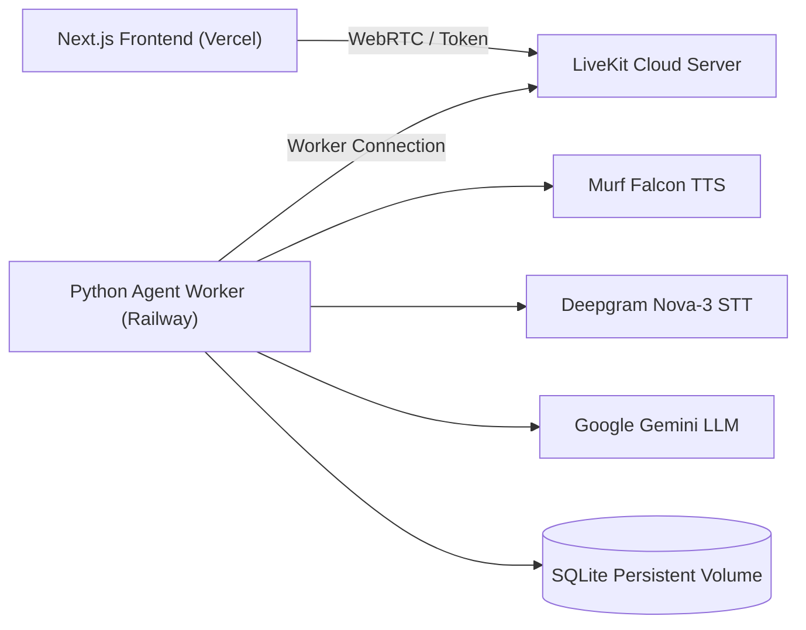

# MyCitiPad Virtual Receptionist — Deployment Guide

This guide outlines deployment of the two-service voice AI architecture:
1. **Backend (Python LiveKit Agent)**: Hosted on a long-lived container runner (e.g., [Railway](https://railway.com)).
2. **Frontend (Next.js Voice UI)**: Hosted on a serverless platform (e.g., [Vercel](https://vercel.com)).

Both services connect via **LiveKit Cloud** as the real-time audio transport hub.

---

## Architecture Overview



---

## 1. Backend Deployment (Railway)

The backend runs as a continuous daemon process running LiveKit Agents.

### Setup Steps:
1. Connect your GitHub repository to Railway.
2. Set the root directory to `backend`.
3. Railway uses the included [`Dockerfile`](../backend/Dockerfile) or [`railway.toml`](../backend/railway.toml).
4. **Environment Variables**:
   ```ini
   LIVEKIT_URL=wss://your-project.livekit.cloud
   LIVEKIT_API_KEY=your_livekit_key
   LIVEKIT_API_SECRET=your_livekit_secret
   MURF_API_KEY=your_murf_key
   DEEPGRAM_API_KEY=your_deepgram_key
   GOOGLE_API_KEY=your_gemini_key
   MCP_DB_PATH=/data/mycitipad.db
   MCP_HUMAN_AVAILABLE=false
   MCP_SIMULATE_FAILURE=""
   ```

### ⚠️ SQLite Persistence on Railway
- **Important:** By default, cloud containers have **ephemeral filesystems**. A container restart or new deployment will wipe `mycitipad.db` if stored in the container layer.
- **Production Solution:** Attach a Railway **Persistent Volume** mounted at `/data`, and set `MCP_DB_PATH=/data/mycitipad.db`.
- **Demo / Evaluation Mode:** If a persistent volume is not mounted, the database reinitializes cleanly on redeploy from the seed script.

---

## 2. Frontend Deployment (Vercel)

The Next.js frontend is deployed to Vercel and serves the user-facing web interface.

### Setup Steps:
1. Import repository into Vercel.
2. Set Root Directory to `frontend`.
3. Build Command: `pnpm build` (default).
4. **Environment Variables**:
   ```ini
   LIVEKIT_URL=wss://your-project.livekit.cloud
   LIVEKIT_API_KEY=your_livekit_key
   LIVEKIT_API_SECRET=your_livekit_secret
   AGENT_NAME=my-agent
   ```

---

## 3. Connecting Backend and Frontend

The frontend and backend do not communicate via direct HTTP REST endpoints. Communication is orchestrated via LiveKit:
1. **Frontend** requests a short-lived room token from `/api/token`, which signs the token using `LIVEKIT_API_SECRET`.
2. **Frontend** connects to the room and publishes microphone audio.
3. **Backend Agent** registers with `agent_name="my-agent"` (matching `backend/src/agent.py`).
4. LiveKit automatically dispatches the agent worker to join the room and start the audio pipeline.

---

## 4. Pre-Flight Verification

After deploying both services:
1. Check Railway deployment logs: verify `worker started` and connection to LiveKit cloud.
2. Open the Vercel URL in a browser.
3. Click **Start Call**, grant mic access, and confirm receipt of the initial greeting:
   *"Hello, thanks for calling MyCitiPad..."*
4. Run a test viewing query and inspect Railway logs to confirm tool execution.
